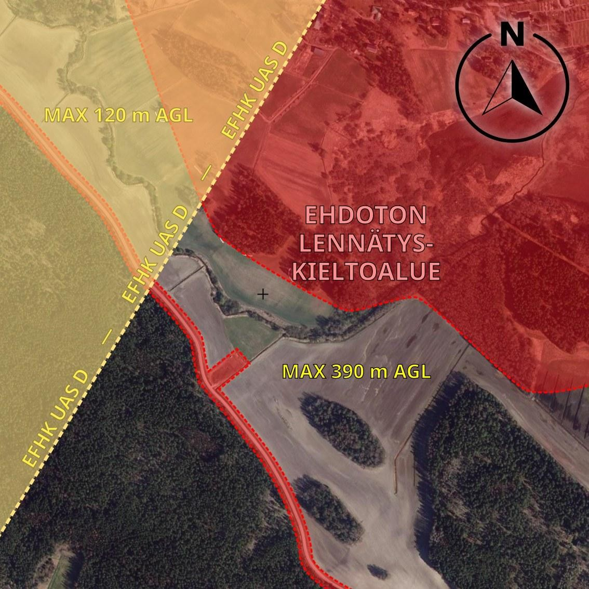
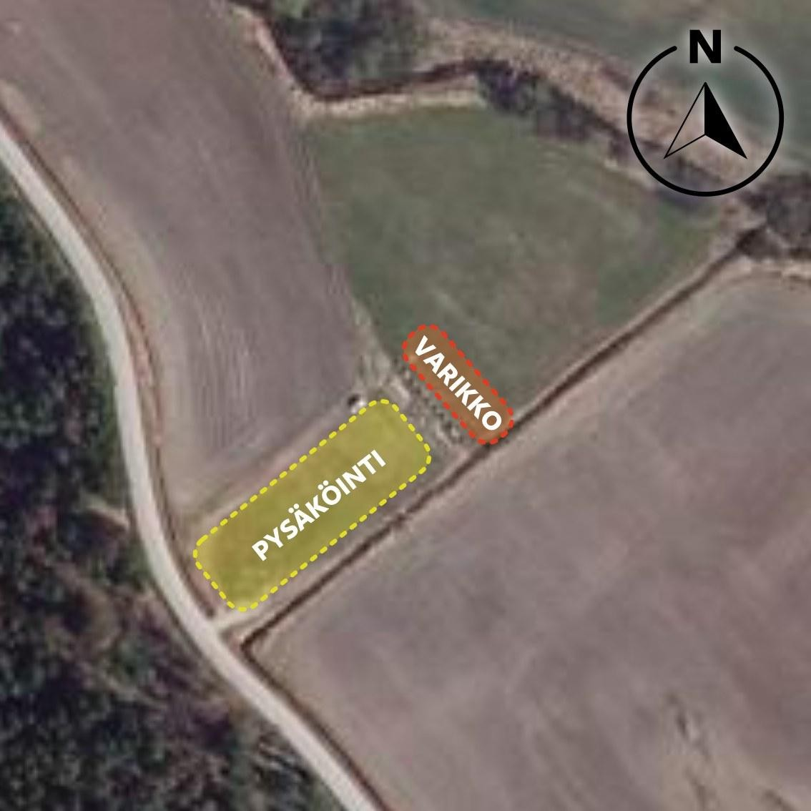
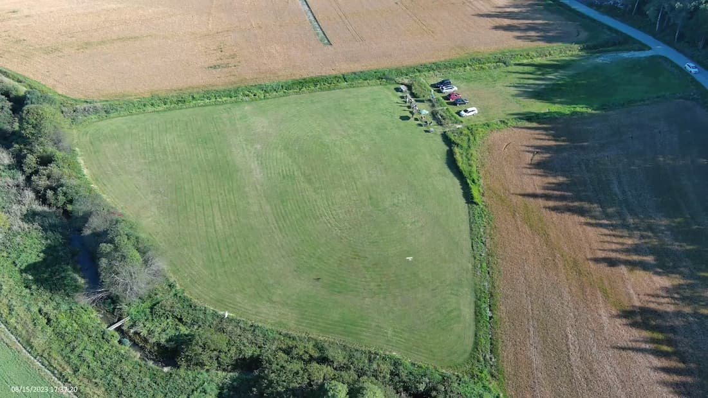

## HELSINKI – TALOSAARENTIEN LENNOKKIKENTÄN SÄÄNNÖT

Vallilan lennokkikerho ry &nbsp; | &nbsp; Versio 1.3 &nbsp; | &nbsp; Voimassa 22.9.2026 alkaen

### Soveltamisala

Kenttä on Traficomin ilmailumääräyksen OPS M1-29 liitteen 3 kohdan a) ”Lennokkien lennätyspaikat (Suomen Ilmailuliitto ry)” mukainen salliva UAS-ilmatilavyöhyke ”Helsinki – Talosaarentien lennokkikenttä UAS”, jonka toimija on Vallilan lennokkikerho ry.

Kentällä sovelletaan liitteen 3 kohdan a) mukaisia vapautuksia komission täytäntöönpanoasetuksen (EU) 2019/947 avoimen kategorian vaatimuksista. Vapautukset ovat voimassa ainoastaan Vallilan lennokkikerho ry:n omassa toiminnassa, Suomen Ilmailuliitto ry:n toimintamallien ja näiden kenttäsääntöjen mukaisesti sekä vyöhykkeen alueella lennätettäessä.

Muiden toiminta vyöhykkeellä on sallittua noudattaen avoimen kategorian tavanomaisia ehtoja ja rajoituksia.

### 1. Kentän käyttöoikeus

- Kenttää saavat käyttää Vallilan lennokkikerho ry:n (VLK) jäsenet. Lisäksi kenttää saavat käyttää:
  - Puolustusvoimien, poliisin ja pelastustoimen toimijat virkatehtäviin liittyvissä lennätysharjoituksissa, kun käytöstä on sovittu VLK:n kanssa.
  - VLK:n kutsumat vierailevat lennättäjät kilpailuissa, koulutuksissa, harjoituksissa ja muissa tapahtumissa.
  - Yhdistykseen kuulumattomat harrastajat, jotka VLK on erikseen hyväksynyt ja jotka maksavat kenttämaksun (kenttämaksut: vallilanlennokkikerho.fi).
  - Yhdistykseen liittymistä harkitsevat harrastajat, joille VLK on antanut luvan tutustua kenttään ja lennättää muutaman kerran.
- Jokaisella lennättäjällä on oltava voimassa oleva kolmannen osapuolen vastuuvakuutus.
- Jokainen lennättäjä on velvollinen perehtymään näihin sääntöihin ennen lennättämistä kentällä.
- Sääntöjen rikkominen voi johtaa lennätyskieltoon tai kentän käyttöoikeuden menettämiseen. Seuraamuksista päättää Vallilan lennokkikerho ry.
- Lennätystoiminnassa ei ole ikärajaa eikä avoimen kategorian tutkintovaatimuksia (A1/A3, A2).

### 2. Lennokit ja radiolaitteet

- Suurin sallittu lentoonlähtöpaino on 15 kg.
- Lennokki merkitään droneoperaattoritunnuksella määräysten mukaisesti. Lisäksi on suositeltavaa merkitä lennokkiin oma nimi ja puhelinnumero.
- Lennättäjä vastaa siitä, että kalusto on asianmukaisesti rakennettu, huollettu ja toimintakunnossa.
- Vain EU:ssa hyväksyttyjä radiolaitteita saa käyttää Suomessa sallituilla taajuuksilla ja lähetystehoilla. Videolähetintä ei saa kytkeä päälle, jos FPV-laitteita on ilmassa.

### 3. Lennätysalue ja lentokorkeus

- Lennätys vain liitteen 1 kartan mukaisella alueella.
- Varikko- ja pysäköintialueen (liite 2) päällä lennättäminen on kielletty.
- Kartalla punaisella merkityt alueet ovat ehdottomia lennätyskieltoalueita.
- Suurin sallittu lentokorkeus kartan keltaisella merkityllä alueella (EFHK UAS D, Helsinki-Vantaan lähialue) on 120 m maanpinnasta (AGL).
- Muualla lennätysalueella suurin sallittu lentokorkeus on 390 m maanpinnasta (AGL).
- Vyöhykkeen tarkat rajat, korkeus ja erityisehdot on esitetty OPS M1-29 -määräyksen liitteessä 3. EFHK UAS D -vyöhykkeen ehdot on esitetty määräyksen rajoittavia UAS-ilmatilavyöhykkeitä koskevassa liitteessä. Molempia noudatetaan.

### 4. Lennätysajat

- Polttomoottorilennokkien lennätys on sallittu joka päivä klo 8–22. Muilla lennokeilla saa lennättää kaikkina vuorokauden aikoina.
- Polttomoottorilennokissa on käytettävä tehokasta äänenvaimennusta, jos se on teknisesti mahdollista ja soveltuu moottorin rakenteeseen.
- Kilpailujen ja muiden tapahtumien aikana kentällä saa lennättää vain tapahtumaan liittyen.

### 5. Lennätystoiminta

- Lennätys tapahtuu pääsääntöisesti suorassa näköyhteydessä (VLOS).
- FPV-lennätyksessä on käytettävä tähystäjää, joka pitää lennokin suorassa näköyhteydessä.
- Poikkeuksena FPV-lennätys ilman tähystäjää on sallittu alle 30 metrin korkeudessa ja enintään noin 200 metrin etäisyydellä kentän nurmialueesta.
- Yölennätyksissä lennokissa on pidettävä päällä vihreää vilkkuvaa valoa.
- Lennokit valmistellaan ja huolletaan varikolla. Nurmialueelle ei saa jättää välineitä, lennokkeja tai niiden osia.
- Lentoalueella ovat vain lennättäjät ja heidän avustajansa.
- Lennättäjien on koordinoitava toimintansa keskenään, esimerkiksi sopimalla lennätysvuoroista, lentoalueen käytöstä ja samanaikaisesti ilmassa olevien lennokkien määrästä. Toiminnassa on huomioitava muut lennättäjät ja kentällä olijat.
- Vallilan lennokkikerho ry:n jäsenillä on etusija kentän käyttöön.
- Nousut, laskut ja kiitotielle meno ilmoitetaan selvästi ääneen muille lennättäjille.
- Lennokki väistää aina miehitettyä ilma-alusta riittävän etäälle ja tarvittaessa laskeutuu.
- Vaarattomien esineiden pudotus (esim. pienoislaskuvarjo) ja pyrotekniikka ovat sallittuja turvallisesti lennätysalueella.
- Lennättäminen päihteiden vaikutuksen alaisena on ehdottomasti kielletty.
- Kentällä on kielletty (viranomaistoimintaa lukuun ottamatta):
  - kaupallinen toiminta
  - suihkuturbiinilennokit
  - miehitettyjen ilma-alusten operointi kentän nurmialueella
- Kukin lennättää omalla vastuullaan ja noudattaa voimassa olevaa lainsäädäntöä, viranomaismääräyksiä sekä Ilmailuliiton ja kerhon ohjeita.

### 6. Poikkeustilanteet

#### HÄTÄTILANTEESSA SOITA 112

- Sijainti: Talosaarentie 108, 00890 Helsinki. Koordinaatit: 60°14′36″N 25°10′42″E
- Vaaratilanteet, onnettomuudet ja sääntörikkomukset ilmoitetaan sähköpostilla osoitteeseen vallilanlennokkikerho@gmail.com.
- Jos tapahtumassa on loukkaantunut vakavasti henkilö tai osallisena on miehitetty ilma-alus, lennättäjän on tehtävä lentoturvallisuusilmoitus Traficomille ja ilmoitettava Onnettomuustutkintakeskukselle (+358 50 5 112 112).

### 7. Siisteys ja kulku kentälle

- Roskaaminen on kielletty. Kenttäalueelle ei saa jättää mitään, ja varikko- ja pysäköintialue on pidettävä siistinä.
- Lennättäjän on varmistettava, että vaurioituneen tai rikkoutuneen lennokin kaikki osat kerätään pois kenttäalueelta ja sen ympäristöstä.
- Ajoneuvot pysäköidään liitteen 2 kartan mukaiselle pysäköintialueelle.

### 8. Lisätiedot

- Lisätietoja kentän käytöstä ja säännöistä: vallilanlennokkikerho@gmail.com
- [Ilmailumääräys OPS M1-29 liitteineen](https://www.finlex.fi/fi/viranomaiset/maarayskokoelmat/traficom-lentoliikenne/2026/5)
- [Avoimen kategorian säännöt (Traficom)](https://traficom.fi/fi/miehittamaton-ilmailu/avoin-kategoria)
- [Komission täytäntöönpanoasetus (EU) 2019/947](https://eur-lex.europa.eu/legal-content/FI/TXT/?uri=CELEX:32019R0947)
- [Yleiset lennokkitoiminnan ohjeet](https://www.lennokkimaarays.fi)

  <h3>LIITE 1: Lennätysalue, kieltoalueet ja lentokorkeudet</h3>
  
  <ul>
    <li>Punainen alue: ehdoton lennätyskieltoalue.</li>
    <li>Keltainen/oranssi alue (EFHK UAS D): suurin lentokorkeus 120 m maanpinnasta (AGL).</li>
    <li>Muu alue: suurin lentokorkeus 390 m maanpinnasta (AGL).</li>
  </ul>

  <h3>LIITE 2: Pysäköinti- ja varikkoalue</h3>
  
  <ul>
    <li>Keltainen alue: pysäköinti.</li>
    <li>Punaisella rajattu alue: varikko.</li>
    <li>Pysäköinti- ja varikkoalueen päällä lennättäminen on kielletty.</li>
  </ul>

  

[Talosaarentien_lennokkikenttä_UAS_v1.3.pdf](/images/Talosaarentien_lennokkikenttä_UAS_v1.3.pdf)

